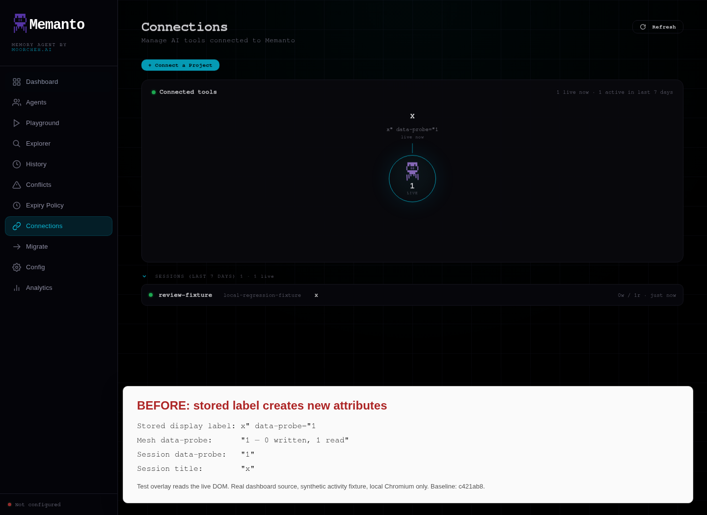
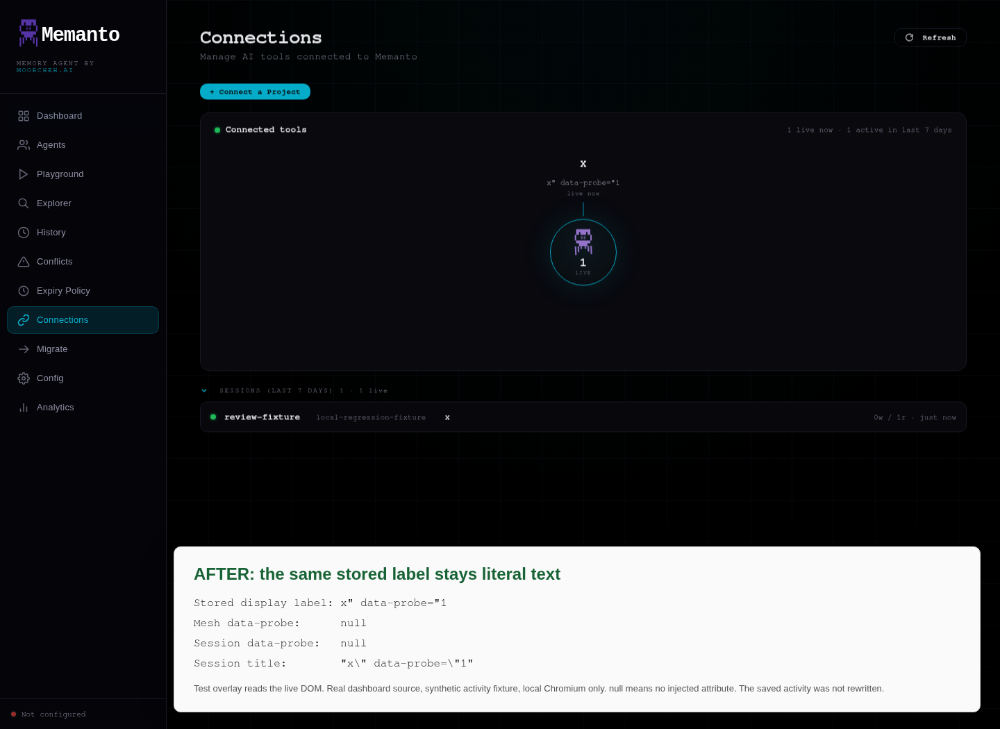

# Dashboard client-label regression evidence

Evidence for the `fix/dashboard-client-label-xss` branch of
[`notkainoa/memanto`](https://github.com/notkainoa/memanto).

These are local Chromium captures of the actual dashboard source with synthetic
activity. Both versions receive the same raw, pre-fix label. The white panel is
an explicitly labeled test overlay reading the live DOM, not a product feature.
No cloud backend, other users' data, or real credentials were used.

## Before and after

| Check | Original UI (`c421ab8`) | Fixed UI (`6a0a308`) |
| --- | --- | --- |
| Injected attribute on mesh node | Present | Absent |
| Injected attribute on session tool icon | Present | Absent |
| Harmless hover handler | Runs on both elements | Runs on neither |
| Previously saved label's title | Truncated to `x` | Full literal label |
| Browser text/attribute round trips | Not asserted | 10 passed |





## Run locally

Python 3.10+ and Chromium are sufficient. No Python packages or hosted API key
are needed for this rendering fixture.

```sh
git clone --branch fix/dashboard-client-label-xss https://github.com/notkainoa/memanto.git memanto
git clone --single-branch --branch evidence/dashboard-client-label https://github.com/notkainoa/memanto.git memanto-evidence
python memanto-evidence/serve.py --repo memanto
```

1. Open `http://127.0.0.1:8765/before/` in an isolated browser.
2. Click **Connections** and wait for the tool node to appear.
3. Run `verify.js` in the page using DevTools or browser automation. Its local
   event handler only writes `data-probe` on its own element.
4. Run `annotate.js` to display the DOM readout used in the screenshot.
5. Repeat steps 2–4 at `http://127.0.0.1:8765/after/`.
6. Stop the fixture when finished.

For example, with Factory's `agent-browser`, after opening the page in an
isolated named session:

```sh
agent-browser eval --stdin < /absolute/path/to/memanto-evidence/verify.js
agent-browser eval --stdin < /absolute/path/to/memanto-evidence/annotate.js
```

`serve.py` serves the original HTML from git and the patched HTML from the
working tree. Only read-only synthetic API responses are provided. The verifier
rejects execution outside the loopback fixture URLs.

The code branch separately includes an authenticated ASGI regression through
the real recall route and persisted activity reader. Its full Python suite
passed: **1113 passed, 24 live-service tests skipped**. This browser fixture
checks rendering; it is not a claim of cloud-backend end-to-end testing.
